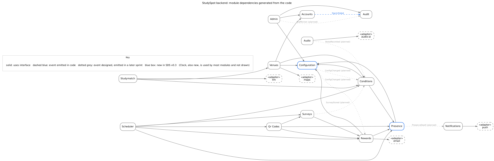

# StudySpot

StudySpot is a mobile app that helps students find a good place to study right now. It combines study-specific café information with crowd, noise and Wi-Fi conditions. Each condition is labelled Current, "X hours ago", or an estimate based on historical data, and never shown as more recent than it is. Students earn points for short receipt-QR surveys and spend them on café coupons, and StudyMatch, an AI assistant, recommends places from real data only.

Software Engineering project, AUC, Fall 2026. Requirements: SRS v0.4; design: SDS v0.3 (Milestone 2).

## Architecture in one picture

A Flutter app talks to one NestJS backend, a **modular monolith**, through a REST API. Inside the backend, 14 modules talk to each other only through interfaces in `backend/src/contracts`, and every outside service sits behind an adapter.



The graph above is generated from the code (`npm run deps:graph`), and CI fails if a module bypasses the interfaces (`npm run deps:check`). The UML diagrams are in [`docs/architecture/`](docs/architecture/).

## Repository layout

```
app/                 Flutter mobile app (M5 Zeina, M6 Hanna)
backend/             NestJS API: modules, contracts, database, tests
  src/contracts/     interfaces + tokens: the only door between modules
  src/modules/       14 business modules (Accounts, Venues, Conditions, ...)
  src/adapters/      Maps, E-mail, Push, LLM, Audio AI (fakes until configured)
  src/db/            entities, migrations, seed loader
  seed/              venue seed data
contracts/openapi.yaml   the API contract between app and backend
docs/architecture/   UML (PlantUML sources + rendered PNGs)
docs/testing/        test plan, test cases, traceability matrix
docs/deploy.md       Render + Supabase deployment
```

## Quick start

You need **Git**, **Node.js 20+** and **Docker Desktop** (running). Then, from the repo root:

```bash
git clone https://github.com/yasmeennasrr/StudySpot.git
cd StudySpot
npm run setup     # checks tools, starts the database, installs packages, creates tables, loads sample data
npm run dev       # starts the backend
```

Run `npm run setup` again after any `git pull`: it is safe to repeat and picks up new packages and migrations. No Docker? Put a Supabase connection string in `backend/.env` and run `npm run setup -- --no-docker`.

| Command (repo root) | What it does |
| --- | --- |
| `npm run setup` | Everything needed to run the project, in one go |
| `npm run dev` | Start the backend with auto-reload |
| `npm run check` | Lint, type check, architecture rules and unit tests (run before a pull request) |
| `npm test` | Unit and API tests |
| `npm run test:int` | Integration tests on a real database (the separate `studyspot_test`, created by setup) |
| `npm run test:matrix` | Rebuild the requirements traceability matrix from the test case sheet |
| `npm run db:up` / `db:down` | Start / stop the local database |
| `cd app && flutter test` | Flutter app tests |

Live (Render): <https://studyspot-api-x8u6.onrender.com/api/v1> · docs <https://studyspot-api-x8u6.onrender.com/api/docs>

Local API: <http://localhost:3000/api/v1> · Interactive docs: <http://localhost:3000/api/docs> · Health: `/api/v1/health`

See [CONTRIBUTING.md](CONTRIBUTING.md) for the team rules, branches and pull requests.

## Sprint 1 status (Milestone 2)

Everything below is merged into `main`, tested in CI, and running on the live API.

| Area | What is built | Owner |
| --- | --- | --- |
| Platform | API layer (validation, one error format, request IDs, rate limit, health), Configuration, Audit Log, Clock, Scheduler, CI, 19-table schema with PostGIS | M1 Mohammad |
| Preferences and favorites | Saved in the database, each user sees only their own (`/me/preferences`, `/me/favorites`) | M1 Mohammad |
| Maps | Google geocoding adapter (offline geocoder until a key is set); browse all venues (`GET /venues`) | M1 Mohammad |
| Accounts & Auth | Register, sign in, refresh, sign out; bcrypt passwords, 15-minute access tokens, rotated refresh tokens, 14-day inactivity, suspended accounts blocked | M2 Karma |
| Search | By name and area, nearby with distance, all FR-013 filters; 15 Egyptian demo venues | M3 Yasmeen |
| Venue details and conditions | Static and dynamic groups; Current / hours ago / historical / unavailable labels; 90 days of sample history | M4 Omar |
| App: foundation and account screens | Flutter app shell, terms, location permission, sign in and register, preferences, favorites | M5 Zeina |
| App: discovery screens | Search list and map, filters, venue details with condition labels | M6 Hanna |
| Deployment | API on Render, database on Supabase ([docs/deploy.md](docs/deploy.md)) | M1 Mohammad |
| Testing | 154 documented test cases from all six members, test plan and traceability matrix ([docs/testing](docs/testing/)) | All, collected by M1 |
| Presence, Surveys, QR codes, Rewards, Audio, Notifications, StudyMatch, Admin | Interfaces and stubs; built in Sprints 2 and 3 | — |

**Live:** API <https://studyspot-api-x8u6.onrender.com/api/v1> · docs <https://studyspot-api-x8u6.onrender.com/api/docs> · sign in as `dev@studyspot.test` / `devpass123`. The free server sleeps after 15 minutes idle, so the first request can take about a minute.

**Run the app:** install Flutter (stable), then `cd app && flutter pub get && flutter run -d chrome`. It uses the live API by default.

## Tech stack

Flutter (Dart) · Node.js 20 + NestJS 11 (TypeScript) · TypeORM · PostgreSQL 16 + PostGIS on Supabase · Render · Google Maps · Google Gemini · SendGrid · Firebase Cloud Messaging · GitHub Actions · Jira
