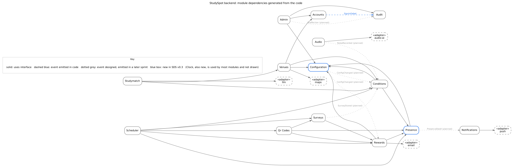

# StudySpot

StudySpot is a mobile app that helps students find a good place to study right now. It combines study-specific café information with crowd, noise and Wi-Fi conditions. Each condition is labelled Current, "X hours ago", or an estimate based on historical data, and never shown as more recent than it is. Students earn points for short receipt-QR surveys and spend them on café coupons, and StudyMatch, an AI assistant, recommends places from real data only.

Software Engineering project, AUC, Fall 2026. Requirements: SRS v0.4; design: SDS v0.2 (v0.3 in progress for Milestone 2).

## Architecture in one picture

A Flutter app talks to one NestJS backend, a **modular monolith**, through a REST API. Inside the backend, 14 modules talk to each other only through interfaces in `backend/src/contracts`, and every outside service sits behind an adapter.



The graph above is generated from the code (`npm run deps:graph`), and CI fails if a module bypasses the interfaces (`npm run deps:check`). The UML diagrams are in [`docs/architecture/`](docs/architecture/).

## Repository layout

```
app/                 Flutter mobile app (M5, M6)
backend/             NestJS API: modules, contracts, database, tests
  src/contracts/     interfaces + tokens: the only door between modules
  src/modules/       14 business modules (Accounts, Venues, Conditions, ...)
  src/adapters/      Maps, E-mail, Push, LLM, Audio AI (fakes until configured)
  src/db/            entities, migrations, seed loader
  seed/              venue seed data
contracts/openapi.yaml   the API contract between app and backend
docs/architecture/   UML (PlantUML sources + rendered PNGs)
docs/testing/        test plan, test cases, traceability matrix
docs/deploy.md       Render + Supabase deployment
```

## Quick start

You need **Git**, **Node.js 20+** and **Docker Desktop** (running). Then, from the repo root:

```bash
git clone https://github.com/yasmeennasrr/StudySpot.git
cd StudySpot
npm run setup     # checks tools, starts the database, installs packages, creates tables, loads sample data
npm run dev       # starts the backend
```

Run `npm run setup` again after any `git pull`: it is safe to repeat and picks up new packages and migrations. No Docker? Put a Supabase connection string in `backend/.env` and run `npm run setup -- --no-docker`.

| Command (repo root) | What it does |
| --- | --- |
| `npm run setup` | Everything needed to run the project, in one go |
| `npm run dev` | Start the backend with auto-reload |
| `npm run check` | Lint, type check, architecture rules and unit tests (run before a pull request) |
| `npm test` | Unit and API tests |
| `npm run test:int` | Integration tests on a real database (the separate `studyspot_test`, created by setup) |
| `npm run test:matrix` | Rebuild the requirements traceability matrix from the test case sheet |
| `npm run db:up` / `db:down` | Start / stop the local database |

API: <http://localhost:3000/api/v1> · Interactive docs: <http://localhost:3000/api/docs> · Health: `/api/v1/health`

See [CONTRIBUTING.md](CONTRIBUTING.md) for the team rules, branches and pull requests.

## Sprint 1 status (Milestone 2)

| Module | State | Owner |
| --- | --- | --- |
| API layer (validation, errors, request IDs, rate limit, health) | Built | M1 |
| Configuration, Audit Log, Clock, Scheduler | Built | M1 |
| Database schema (19 tables, PostGIS) and migrations | Built | M1 |
| Saved preferences and favorites (stored in the database, own data only) | Built | M1 |
| Google geocoding adapter (offline geocoder until a key is set) | Built | M1 |
| Deployment: Supabase database ready, Render blueprint ([docs/deploy.md](docs/deploy.md)) | Database live; API deploy pending | M1 |
| Test plan and traceability matrix ([docs/testing](docs/testing/)) | Built | M1 |
| Accounts & Auth | Stub with dev token, real version in progress | M2 |
| Venues search, nearby, filters | Stub on sample data, real version in progress | M3 |
| Venue details, Conditions | Stub, real version in progress | M4 |
| Presence, Surveys, QR Codes, Rewards, Audio, Notifications, StudyMatch, Admin | Interfaces and stubs; built in Sprints 2 and 3 | — |
| Flutter app | In progress | M5, M6 |

## Tech stack

Flutter (Dart) · Node.js 20 + NestJS 11 (TypeScript) · TypeORM · PostgreSQL 16 + PostGIS on Supabase · Render · Google Maps · Google Gemini · SendGrid · Firebase Cloud Messaging · GitHub Actions · Jira
